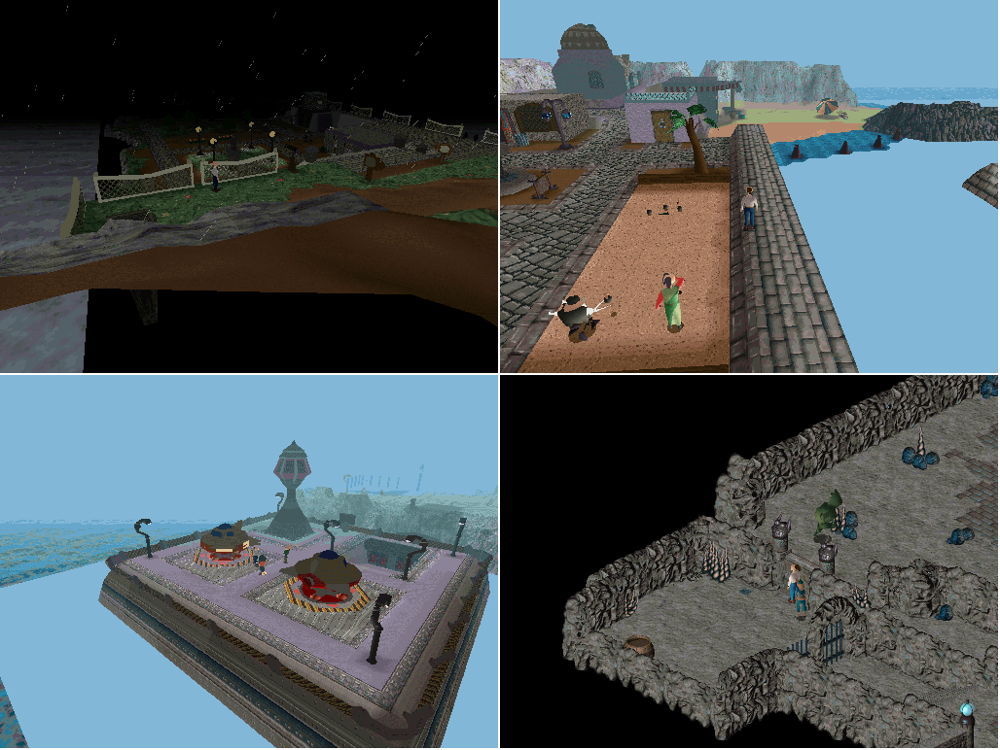
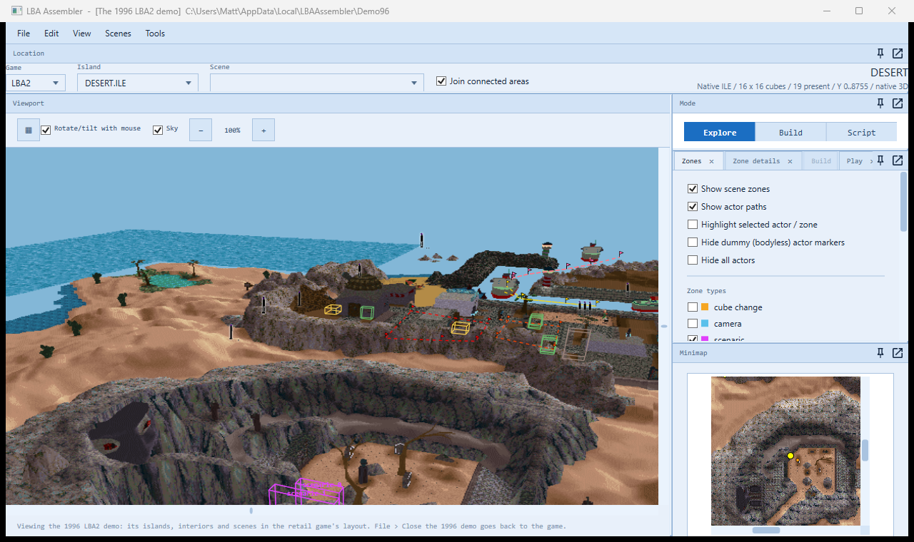
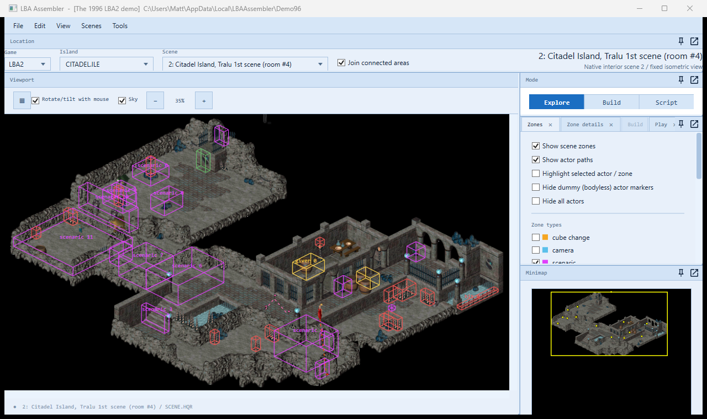
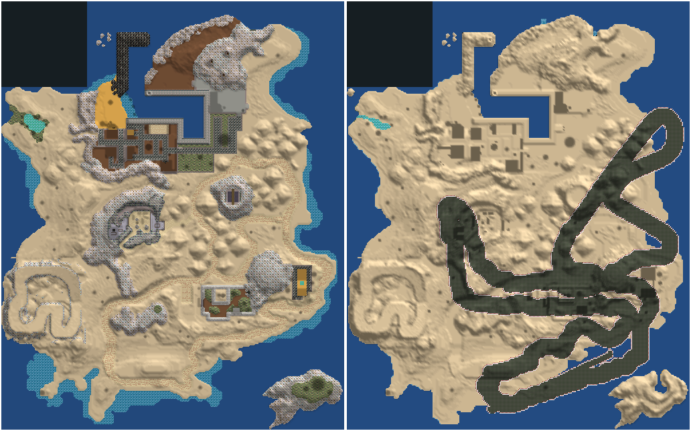

# The 1996 LBA2 demo in LBA Assembler (2026-10-05)

A demo of LBA2 was released in 1996, before the game was finished (`LBA2DEMO.EXE`, a DOS/4GW program). Its folder holds
the game's usual files -- `SCENE.HQR`, `BODY.HQR`, `RESS.HQR`, `LBA_BKG.HQR`, four islands (`CITADEL`, `CITABAU`, `DESERT`, `OTRINGAL`
`.ILE`/`.OBL`) -- but most of them are in earlier versions of the formats, so neither the retail engine nor the editor reads them as they
are. LBA Assembler converts the demo once into the retail layout, in a folder of its own, and then shows it as it shows the game.

## Opening it

- **File > Open the LBA2 1996 demo...** and choose the demo's folder (the one with `LBA2DEMO.EXE`). The first time, it is converted
  (a few seconds) into `%LOCALAPPDATA%\LBAAssembler\Demo96`; after that the converted copy is reused, unless it was made from another folder
  or by an older converter.
- The window title then starts with "[The 1996 LBA2 demo]". The islands, interiors and scenes are in the usual menus; a scene the demo
  shares with the retail game is named after it (59 of the 66), the others "<island>, an interior only the 1996 demo has".
- **File > Close the 1996 demo** goes back to the game folder.
- From the command line: `LBAAssembler.exe --demo96 <demo folder> [scene]`.

The demo folder and the game folder are only read. The LBA2 game folder must be set (File > Settings): the engine's start-up files,
which the demo has none of, come from it (below). While the demo is open, the settings are not saved (as with File > Test edits), so the
game folder in them is never replaced by the demo's; the joined interior maps (made for the retail scene numbers) are off.

## What converts, and how well

| Part | Result |
|---|---|
| Scenes | 66 of 66. 59 match a retail scene (outdoors by island and cube; interiors by the grid they are drawn with) |
| Islands | 4 of 4, ground, heights, textures and decors |
| Interiors (grids, libraries, bricks) | all; already in the retail format, only the file's header differs |
| Bodies | 116 of 116 characters (3 partly), 56 of 56 objects, all island decors (323) |
| Animations | the retail format but for the keyframes' times: the demo's are in 1/50 s ticks (Twinsen's walk 15, 10, 10), the retail game's in ms (300, 200, 200) -- multiplied by 20, or every character moves 20 times too fast |
| Sprites, texts, samples, screens, flows | copied as they are: the retail format |
| Scripts | 66 of 66 scenes, translated into the retail bytecode (the demo's script language, below); they run in the retail engine |

What the editor does with it:
- every island in 3D with its actors and zones, the minimap, the scenes' interiors, actors, zones and track points;
- the engine's renderer draws the scenes (the picture at the top: storm Citadel, scene 48; the Desert village, scene 60; the Otringal
  spaceport, scene 29; the caves of scene 2, which matches the retail "Tralu 1st scene").

What the demo is: an earlier, different game in places. The Desert Island is laid out differently from the retail one -- the same
outline, but the buildings, the temple, the paths and the rocks are elsewhere:

Its Citadel Island interiors are early versions of the retail scenes 0-22 and its Citadel outdoor scenes are the retail 42-50, mostly
under the same numbers; the Desert Island's are partly renumbered (demo 13-65 against retail 55-73) and the Otringal ones are all
renumbered (demo 23-35 against retail 87-92). Seven interiors match nothing in the retail game (demo scenes 6, 12, 17, 18, 26, 30, 37).

## The format differences (what the converter does)

`Demo96/Demo96Converter.cs` (with `Demo96Scenes.cs` and `Demo96Bodies.cs`); the same conversion from the command line:
`ScriptRoundTrip demo96 <demo folder> <out folder> [retail folder]`.

**`SCENE.HQR`**
- No entry 0 (the retail game's "largest scene" size): demo scene N is entry N, retail entry N + 1. The converter writes the size entry.
- The ambient sample slots are 3 numbers each, not 5: the retail frequency (4096) and volume (110) are added.
- Each actor has 40 more bytes after its armour and life points (20 numbers, mostly animation numbers or -1); the retail game has no use
  for them and they are dropped.
- No patch table at the end: rebuilt from the decoded scripts. For the 22 scenes whose scripts don't decode, the table is left empty.
- One actor flag (1 << 18, "3DS animation" in the retail game) is cleared: the converted actors have no 3DS animations.
- Zones and track points are the retail format.

**Bodies (`BODY.HQR`, `OBJFIX.HQR`, the `.OBL` decors)** -- a format between LBA1's and LBA2's:
- a 16-byte header (flags, 2 = animated; bounding box; extra size), then the points (6 bytes each);
- bones (animated bodies only): 8 bytes each (point count, first point x 6, parent x 36, normal count);
- normals: 8 bytes each;
- untextured polygons are LBA1's (types 0-10; 7 and 8 carry a face normal, 9 and 10 a normal per point) and map onto the retail types
  {0:0, 1:4, 2:4, 3:4, 4:0, 5:2, 6:3, 7:1, 8:1, 9:4, 10:5};
- textured polygons are types 11-36: types 12, 16, 20 and 24 start with a face normal; then 4 bytes a point (normal, point x 6), the
  texture word (the retail texture table entry) and the texture co-ordinates (the retail values). The retail type is the demo's minus 3
  (8-23); 36 is the retail 10;
- lines and spheres are LBA1's (8 bytes).

Three bodies don't read to the end (`BODY.HQR` 4, 70 and 103: a polygon past the retail engine's 550, a point outside the body, a polygon
of no points -- perhaps unfinished data); the polygons up to there are kept.

**Islands (`.ILE`)**: the same container; the ground texture definitions are 8 bytes (three corners in whole pixels) instead of 12 (8.8
fixed point), converted to the middle of each pixel. Without it the ground textures are scrambled.

**`RESS.HQR`** is rebuilt in the retail layout:
- the demo's palette (entry 0) is followed by its 64 K shading table and a 36-byte trailer (fog colour, shading start/normal/end); entry 9
  is the storm version. The retail engine wants a palette file per island (the XPL entries 27-42): they are made from these -- the storm
  one for 27, the fine-weather one for the rest -- with a 50 % blend transparency table;
- the demo's font, skies (Citadel 11, Desert 13, fine-weather Citadel 26; Otringal has none of its own and gets Citadel's) and
  `FILE3D.HQR` (the entities: one entry each, packed into the retail entity table, entry 44);
- from the retail game: the memory sizes, inventory pictures, 3DS animations, flows and impacts.

**`LBA_BKG.HQR`**: a 7-number header against the retail 6 numbers and 4 sizes; rewritten, with the brick buffer sizes worked out.
The block libraries' floor codes (each block cell's second byte) are LBA1's way round (converter version 5, `Demo96Converter.BlockCode`):
the retail engine takes the high half for the game code (1 water, 2 electrified, 3-6 the moving walkways, 7 the dome's maze, 9 lava, 11
gas, 15 animated water) and the low half for the footstep sound; the demo's engine (`LBA2DEMO.EXE`: its drowning test at 0x32402, its
footsteps at 0x1D9D4, its maze blocks at 0x282EA) takes the low half for the game code when the high half is all ones, and the low half
for the footstep otherwise. The demo's plain floor is 0xF0 (170 of the 202 blocks of its library 1, the Citadel interiors'): read as
retail, 15, animated water -- Twinsen drowned on the dry stone of the sewers and the School. Now 0xF? is (low half) << 4, the game code
alone (0xF1, the sewers' water, is 0x10 as retail library 1 has the same blocks), and any other code is its low half, a footstep.

**From the retail game folder** (the demo has none of them; they are only copied into the converted folder): `ANIM3DS.HQR`, `LBA2.HQR`,
`HOLOMAP.HQR`, and an empty `video\VIDEO.HQR` the engine needs to start.

## Two engine fixes it needed

Both in `native/lba2-classic-community/SOURCES/3DEXT/`, both harmless for the retail game:
- `RENDERER_ACTORS.CPP`: the island actor scan assumed the retail game's 222 scenes; it now reads how many `SCENE.HQR` has.
- `RENDERER_API.CPP`: the renderer kept the last palette's number across a change of game folder, so after opening the demo (or closing
  it) it kept a palette buffer that was gone and drew black. It is reset when the renderer starts again.

## The demo's script language

Found by disassembling `LBA2DEMO.EXE` (a DOS4GW LE executable; Watcom, as the retail `LBA2.EXE`) and lining its interpreter up against the
retail one (2026-11-03). Its life interpreter's switch (jump table at 0x236EC) runs 0-148, retail's 0-154; its conditions 0-40 (retail
0-45) and its track instructions 0-39 (retail 0-52). For each case, how far it moves the script pointer gives the instruction's length.

- **The conditions** are the retail ones: the same operand bytes and the same answer types.
- **The track instructions** are the retail ones but for `SPRITE`, whose sprite number is one byte (retail: two).
- **The life instructions** are the retail ones but for:
  - `SAMPLE`, `SAMPLE_RND`, `SAMPLE_ALWAYS`, `SAMPLE_STOP`: a one-byte sample number (retail: two); `REPEAT_SAMPLE` a byte sample and a byte
    count. (Reading them as retail is what threw the scripts out: the byte after the sample number was taken for an instruction.)
  - 132 (no operand): the talking actor says its line for the chapter. The hero says one of a few picked at random from a table in the
    executable (0x80B0A: chapter 0 "Hello", "Bye", "Hi"; chapter 1 the lighthouse keeper ones); any other actor its own -- the 40 bytes a
    demo actor record carries are its 20 chapter lines. Nothing at chapter 20 and above.
  - 70 (two bytes): an island decor object shown or hidden (scene 42 only); 72 (none): the holomap's icon; 88 (an actor): extras thrown
    about it; 99 (none): a palette call. Not used by the scenes, but for 70.
  - 69, 73, 83-87, 90-92, 103, 104 and 111 have no case in the demo's engine (they do nothing there), yet its scripts use `ASK_CHOICE` (69)
    and `ASK_CHOICE_OBJ` (91) with the retail operands: the scripts were compiled for a newer language than the demo runs.

`LbaScript/Demo96Tables.cs` is that language (`Opcodes.Demo96`). The converter (`Demo96/Demo96Scripts.cs`) decompiles every script in it,
rewrites 132 as `switch (chapter())` with `message()`s (the hero's a `switch (rnd(n))` inside) and drops the other four with a comment, and
compiles the text again in the retail language. The demo's sewers (scenes 17 and 18) run so in the engine: the painter walks his track.

The tools: `ScriptRoundTrip scriptdump <folder> <out> all demo96` (every script's text, in the demo's language), `scriptbytes`, and the
Python disassembly scripts in `E:\dump\TEMP\demo96\dis` (capstone; `switches.py`, `advance.py`, `case.py`).

The texts: the demo's `TEXT.HQR` isn't laid out as the retail one (its English Citadel dialogue is its "file 7", where the retail game has
file 3), so a script's `message(236)` is the demo's text 236 of that file, not the retail game's.

## As a game patch, later

The pictures, islands, interiors and characters are all there, so "the demo's scenes in the retail game" is within reach. What it needs:

1. **The scripts.** Done: translated into the retail bytecode (above).
   - **The interiors** need their block libraries brought over. The demo's Citadel interiors (sewers 17 and 18, and 2, 3...) are drawn
     with demo libraries the retail game doesn't have: only 3 of the 80 blocks of sewer 17 are in retail library 1 as they are. Their
     bricks are mostly retail ones under other numbers: of the 1,072 bricks of demo library 1, 1,020 are, and 52 are the demo's own.
     `ScriptRoundTrip bkgcompare <retail> <converted demo> <scenes> [retail library]` measures it. The plan for the race mod's sewers is in
     [LBRA_STORY_SCRIPT.md](LBRA_STORY_SCRIPT.md#the-1996-demos-sewers).
2. **Texts and voices.** The scripts' text numbers are the demo's own `TEXT.HQR`; a patch would add them to the retail texts (or keep the
   demo's) -- there are no demo voices.
3. **Scene numbers.** The demo's scenes would go past the retail 222 (or replace retail scenes), with their cube-change zones renumbered
   and the holomap told where they are.
4. **What is missing**: Otringal's sky, three partly-read bodies, and the demo's music (its `MIDI_*.HQR` files are not converted).

The scenes already open in the engine (the picture at the top), their scripts running. Not checked yet, scene by scene: that each behaves
as it did in the demo (the texts, item 2, are the first thing that would differ).

## In the race mod: the School of Magic

The user, 2026-11-03: "The demo scenes for the school of magic, let's switch them in to our race mod in place of the retail school of
magic scenes". Every race-track build now puts the demo's School (its scenes 27 and 28) into the retail game's slots 27 and 28
(`Demo96/Demo96Rooms.cs`, from `RaceTrackService` right after the build's originals are put back, before the story):

- **Where the demo comes from**: the package the program carries, `Demo96\rooms.zip` (embedded by LBA Assembler and LBRA's installer --
  the user, 2026-11-03: "We should ship the demo school packaged inside the installer"): a converted demo cut down to the entries the
  School takes (its two scenes, grids, library and the bricks it names, the characters' 5 bodies and 25 animations, its sprites, the entity
  table, the palette), 478 KB, made by `ScriptRoundTrip demo96pack <converted demo> Demo96\rooms.zip` -- installed from it, the game's
  files come out byte for byte as from the whole converted demo. `LBA2_DEMO96` (a converted folder, or the demo's own) comes first;
  the editor's converted copy (File > Open the 1996 demo) is used when a build carries no package.
- **The interior**: the demo's grids in grids 27 and 28, drawn with the demo's block library 1 (202 blocks) as a library of its own
  (LBA_BKG's 18th); its bricks are the retail ones where they are the same, the rest added (`MapBricks.Install`, as a map's interior goes in:
  a build again adds nothing).
- **The people**: the demo's characters as new entities, their bodies and animations the demo's (its scripts name its generic numbers, and
  its skeletons aren't retail's): the Dean (demo entity 62), his assistant (63), the students (64), the props (11) and entity 34. Twinsen and
  the Meca-penguin slot (demo 9, retail 14) are retail's. Twinsen's animations in the demo's scripts are put in the retail numbers
  (`Demo96Rooms.HeroAnims`): 0-22 are the same, but from 25 on retail put in more of them before the ones the two have alike (the demo's
  25 is retail's 27, 34 is 48, 37 is 51, 39-43 are 54-58 -- matched keyframe by keyframe, the demo's entity 0 against retail's). The
  hall's animation 34 (ANIM.HQR 14 in both: retail's 48) played as retail's 34, the skates backwards.
- **The scene**: the slot's header (light, ambience, music), the demo's actors, zones and track points. Doors: the demo's scene numbers
  as retail's; the hall's door into the training room (retail scene 33, which the demo shut) as retail's hall has it.
- **Sounds**: demo samples 35 and 41 are retail 617 and 501 byte for byte; 122 (the flow points') is retail's 441, as its hall plays there.
- **Texts**: the demo's School lines are the retail Desert texts under the same numbers (`match.py`: 28 of 43 the same French line), so
  every language and the voices come with them. Differently worded in the demo: 9, 11, 15, 19, 23, 55, 56, 60, 69, 76, 77, 102, 661, 662,
  666 -- the retail line is shown.
- **The story**: the Desert's Dean (chapter 3) is copied from the hall as the build has it -- the actor at the Dean's place -- and the
  game's hidden.
- **The hall's welcome** (2026-11-05): in the demo the greeter (the hall's actor 10) said its line (demo text 11, the story's welcome)
  only once Twinsen had opened the chest at the far wall (actor 7: Action in zone 5, facing it -- the hero's own script plays the pull
  and sets the chest's track; punching it from the floor doesn't reach), and with it opened the gate (actor 8) up to the Dean's floor
  and set the game's variable 61 to 1 (which also unlocks the entrance hall's upper door, scene 28's actor 4, onto the Dean's side of
  the gate). So the welcome waited for the chest, not for Twinsen coming in. The story now has it said 0.7 s after Twinsen comes in
  while 61 is 0 and sets 61 to 1 there, and 62 to 3 (the Dino-Fly's errand: the School found) as the greeting did (the gate and the greeter gone on later visits, the upper door open, as the demo has them after
  the chest); the chest still opens the gate on that first visit (`RaceTrackStory.Desert.cs`).
  The way to the Dean on foot, checked in the engine (the playthrough's ch03 `08_school_hall.step`): shut, the gate (a sprite door
  between the lamp pillars at x 23808, its opening z 3072-4096) stops Twinsen on the stairs up to it (x 24314); open, he walks through
  it at its middle (z 3584 -- a path nearer z 3072 catches on the pillar, grid cell (46, 5), which looked like a gate that never
  opened), along the walkway, up the stairs (x 19968-21504, slopes) to the bench floor, and jumps (sporty) the one-brick step onto the
  Dean's tier (the demo's Dean walked down to Twinsen instead; the story's stands on his dais).

Checked (a build of all 15 islands, E:\dump\TEMP\allstory4): the halls drawn as in the demo, the Dean and his assistant in the demo's
bodies; the Dean's beats (Q_PAGES 1 -> 2, 5 -> 6 and the diploma); the door to the desert (28 -> 61); the training room's door shut at that
point of the story as retail's is; 10426/10426 scripts round-trip; a second install adds nothing to LBA_BKG.HQR.

## In the race mod: Citadel Island's sewers

The user, 2026-11-03: "Let's make sure we swap in the citadel sewers tomorrow". The demo's sewers (its scenes 17 and 18: the painter
repainting the signs, the barrels, the far halls with their lift up to the harbour district) go into the game's slots 17 and 18 on every
race-track build, after the School (`Demo96Rooms.Sewers`, the same package `Demo96\rooms.zip`, the same block library):

- **Doors in**: every door of the game's into the slots is pointed where the demo's door from the same scene lands (`Doors`): scene 21
  and 34 into 17 at the demo's places, the lift down from scene 48 into the far halls (18), the Tavern's cellar lift onto the demo's cellar
  lift platform. The storm track's lift (scene 42), which the demo hasn't, lands where the demo starts Twinsen in the sewers
  (20357, 1536, 15140) -- on the cellar lift's platform the demo's lift ride starts, and Twinsen, come any other way, fell and drowned.
  The demo scenes those doors are in go into the package too.
- **Texts**: the demo's Citadel texts aren't the game's numbers here (`SewerTexts`): Twinsen's greetings 6 and 102 are the game's 100
  and 101, his questions after the lighthouse keeper 105 and 106 the game's 520 and 107, the broken device's 383 the game's 110 ("It's
  locked."); the painter's 236 and 237 are the game's under the same numbers.
- **Sounds**: demo 54 is retail 126 byte for byte; 118 (the painter's splash) is the demo's own number, which no retail script plays.
- **The story** (chapter 1): the thief's hatch on the harbour quay (moved a cell in front of the railing -- behind it Twinsen couldn't
  reach it -- and its sprite a carrier, OBJ_CARRIER, as the game's hatches are: a sprite is solid, and it pushed him off its own door)
  lands Twinsen at the demo's start; the demo's painter (actor 7) tells of the thief while he is ahead; the thief is cornered by the
  barrels beside the far halls' lift (12800, 3072, 2300), the ladder up to the quay there.

Checked (a build of all 15 islands from the package, E:\dump\TEMP\allstory10): the hatch takes Twinsen into the demo's sewers, safe
after 500 ticks; in the far halls the thief is cornered (213 3 -> 4), Action beside him gives back the gloves and the umbrella (213 5,
items 7 and 20), and the ladder brings him out on the harbour's quay; the doors from 21, 34, 42, 48 and the cellar land where listed;
10400/10400 scripts round-trip. The lifts (the cellar's, 42's, 48's) weren't ridden: a headless test can't work a lift.

Two bugs found in Story Mode (2026-11-05), both fixed above:
- **Drowning on dry land all over the sewers** (and the School): the demo's floor codes read as retail's, 0xF0 as animated water. Of the
  top surfaces of the rooms' grids, 529 dry ones in scene 17, 557 in 18, 330 in 27 and 112 in 28 drowned Twinsen; now only the water does
  (1,992 cells in 17 and 892 in 18, the block the retail library has as water too). Checked in the engine by teleporting Twinsen onto every
  dry cell with head room in the four rooms and LBA1's secret room (scene 226, made from LBA1's own codes: it had none to begin with)
  and standing him there (`ScriptRoundTrip`-made Citadel build, E:\dump\TEMP\agent_sewers): before, every sampled dry cell drowned him
  (14 of 14); after, none of the swept cells did, and the water still does.
- **Stuck coming in from the Weather Wizard's house** (scene 21 into 17, zone 12): the demo walks Twinsen through the door with its
  animation 37 (the step-through walk, retail's 51); retail's 37 is a punch with the left glove, which doesn't move him, so his
  `goto_point(13)` never got there and he punched on for ever. With `HeroAnims` he walks in, reaches the point and is free to walk.
