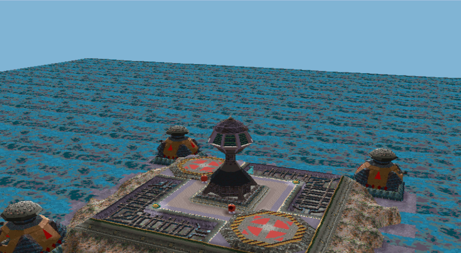
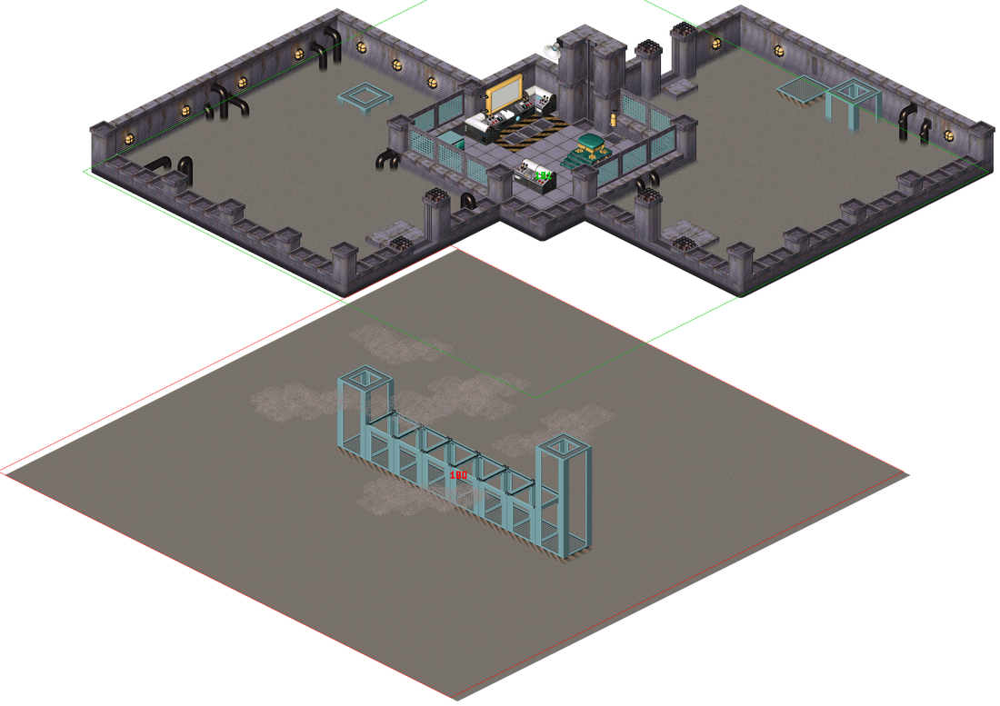
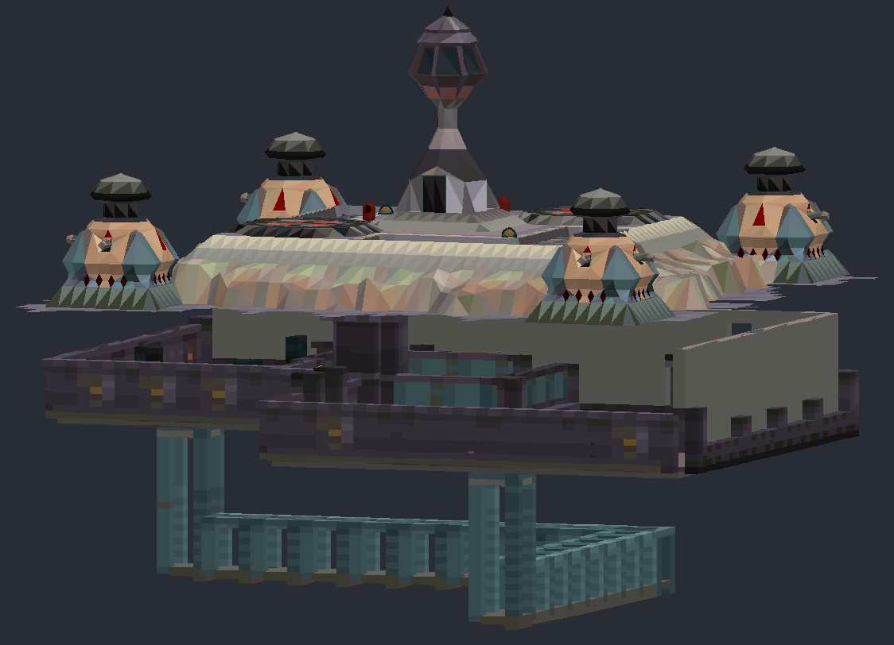
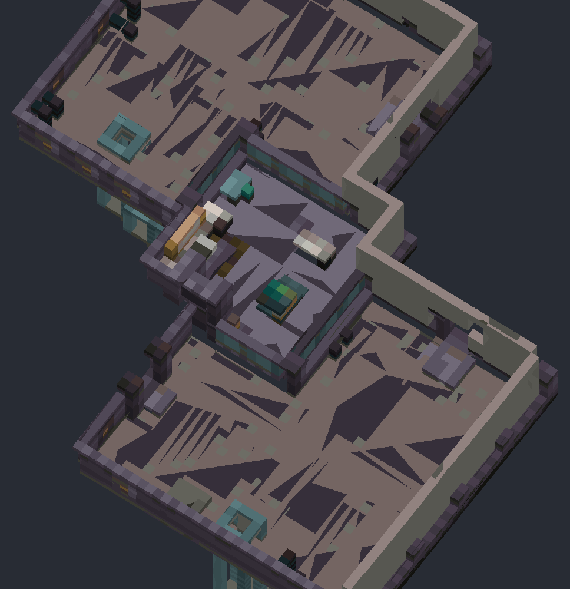

# Island CX's control tower, lower level, in 3D (2026-10-08)

The user: "Let's convert The "control tower, lower level" into a 3D island. The way we currently display it in the editor isn't how they
connect together 180: Island CX, Secret passage (room #126) needs moving underneath 181: Island CX, Room in the emperor (room #127), and
we'll probably need to do a little bit of stretching so it all fits where it's meant to. This is going to be an extra area for our island
CX track, we're going to start outside, enter through a door, drive around inside, and come back out again".

## The two scenes

- **181, the room** ("Room in the emperor..."): two L-shaped halls round a control room, the whole 64 x 64 cells of the scene. The halls'
  floor is layer 0. Three doors lead outside (Island CX's outside scene, 110), each with a landing two layers up (768) at the threshold.
  Two grates in the floor are the zones down into the secret passage: one in the south-west hall at cells (9-10, 34-35), one in the
  north-east hall under a four-legged frame at (46-47, 2-3).
- **180, the secret passage**: a walkway with a cage-like frame, four cells wide, hung between two open-frame shafts (cells x 21-24
  and 49-52, rows 34-37) over a floor far below with clouds over it. The shafts' tops are where Twinsen comes down from the grates: the
  first shaft's top is at layer 17, the second's at 24. The walkway's floor is layer 2.

The two don't fit as they are. The grates are 37 cells apart east and 32 north, but the shafts are 28 cells apart and in a straight line,
and their tops are 7 layers apart.

## In the editor's joined map

The map used to put the passage beside the room (moved 51 cells east so the two didn't overlap). Now it is underneath (`Lba2Areas`):
- the first shaft is under the first grate: 13 cells west and a row north, where both zones between the scenes put it;
- the whole passage is below the room's floor: the second shaft's top (layer 24, the passage's highest) is a layer under it;
- the room is lifted 54 layers on the picture so it stands clear above the passage, the way the Dark Monk Statue's levels are
  (`lba2screenlift <folder> 24 order=180,181`). The map counts as stacked (`IsStacked`): its scenes share plan columns, not cells.

The flat picture can't stretch the passage, so only the first shaft lines up there. The 3D island has both.

## The island: CXTOWER.ILE and CXTOWER.OBL

2026-10-12, the user: "The CX tower we created looks terrible, the top part should be identical ILOTCX.ILE. The other sections we combined
into it should be below the top part vertically, almost as though they're under the gas layer". (The first version made Island CX twice its
size with its buildings replaced by the room, roofed, and the tower on the control room.)

- **The top**: Island CX as it is -- its ground, its two L-shaped buildings in their trenches, the block and the control tower, the landing
  pads -- nothing moved, scaled or taken away.
- **The room** (`Terrain/ControlTower/ControlTowerIsland.cs`): Island CX is one cube, and the room is the inside of its two buildings and the
  block between them at twice their size: its 64 cells are the whole cube, the plateau's 32 in its middle. So it lies under the island cell
  for cell, each hall under its building, the control room under the tower. Every filled cell is a box a brick across and a layer high, in
  its brick's colour matched in Island CX's palette (RESS 36); only the faces that show are kept, merged into rectangles of one colour, in
  bodies of 16 x 16 cells; the filled cells are merged into collision boxes (`Terrain/Palace/BrickBuilding.cs`, shared with the Palace
  island). Its highest wall's top (layer 19) is 512 under the gas (the sea round the island, height 0): the floor is at -5,632. No roofs:
  under the gas there is nothing for them to hide the halls from (`--roofs` puts them on).
- **The secret passage** hangs under the room as before, stretched to fit: the first shaft under the first grate, its posts 7 layers longer
  so its top reaches the floor as the second's does; the walkway's 24 cells repeated along an L -- east from the first shaft for 33 cells,
  a corner, north for 27; the second shaft under the second grate. Its floor is at -11,520. The two grates are open.

Counts: the room is 6,726 cells and the passage 1,310: 26 bodies (6,468 faces) and 373 collision boxes, 437 objects in the cube with
Island CX's own. The retail engine draws 200 objects a cube at most (`MAX_OBJ_DECORS`, the length of the frame's list of them to sort
and draw); this editor's engine draws 1,000 (`3DEXT/LBA_EXT.H`, and the editor's `IslandDecors.MaxPerCubeOwnEngine` for islands only it
plays -- other islands are still kept to 200). `CXTOWER.OBL` is `ILOTCX.OBL` with the building's bodies added at the end (from body 14 on).
(A wall's outer face on the cube's far edge has its middle in the next cube, which Island CX hasn't got: `BrickBuilding` puts such a body a
unit back.)

No scenes yet, and no way down to the halls: a race track on it comes later (in through a door, round the halls and out again), and its
way down with it.

## Making it

- Tools > **LBA2: Island CX control tower (3D)…** (`MainWindow.ControlTower.cs`) adds the two files to the game folder, builds them again,
  or takes them out. It is refused while test edits or the 1996 demo are open. The island appears in the Island list as `CXTOWER.ILE`
  (Island CX's palette).
- `ScriptRoundTrip cxtower <game folder> <out folder> [source folder] [--roofs] [--closed-grates]` builds the same files into another
  folder. The source folder holds pristine `ILOTCX.ILE` and `.OBL` (the game folder by default).
