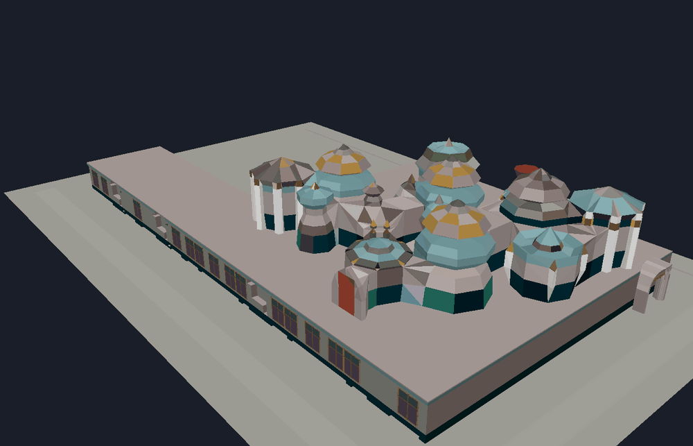
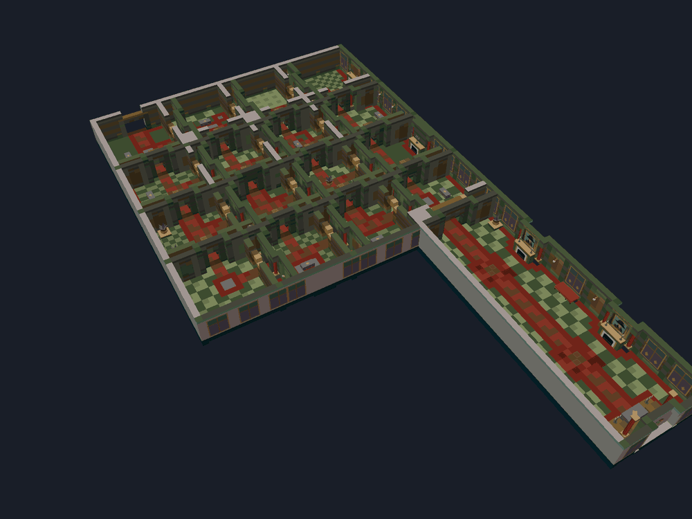
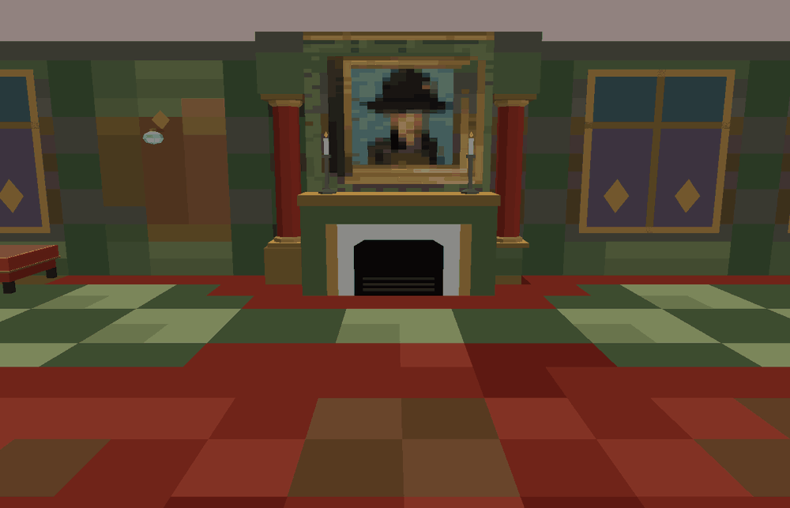

# The Palace island: Otringal's palace as a building of its own (2026-10-08, its outside and furniture 2026-10-12)

The user: "We need to create a new track based on the Palace that's featured on Otringal, this will need to be recreated as a new island.
The idea behind this track is that the cars race through the inside of the palace, through the window by the chest that Twinsen normally
leaves by then around the roof tops. To accomodate all of this we'll probably need to scale up everything. After this is created we'll add
a track to it later, let's just get our Palace island created for now".

And then (2026-10-12): "The Palace island we created needs work. We need to add in the outside of the palace as featured in Otringal.ile
... Let's also see if for each inside room of the palace we can recreate the decor that each room naturally has".

## What the palace is in the game

The Emperor's palace is not on Otringal's island file at all: it is an interior, a maze of sixteen rooms (scenes 151-166), each a grid of
13 x 13 cells, four by four, and the last room (scene 80: the chest, and the round window Twinsen leaves by) off its fourth row. An
interior's cells are bricks -- pictures, not shapes -- so the palace has no 3D model to drive through. Its outside is on Otringal's island
(cube (8, 7) of `OTRINGAL.ILE`): domed octagonal halls of `OTRINGAL.OBL` (bodies 33-49), five times smaller than the rooms and of another
shape; its arch and porch lead into room 154.

## The island

`Terrain/Palace/PalaceIsland.cs` builds two new files, `PALACE.ILE` and `PALACE.OBL`:
- **The rooms where the doors between them put them**: the editor's joined map of the palace (`Lba2Areas`), without the cell it moves some
  rooms apart for its picture (neighbours share their walls here).
- **Scaled up for the cars**: every cell is a box 3 bricks across (1,536 units) and 2.5 layers high (640 units). The palace comes to
  168 x 303 cells of the island and 14 layers.
- **Colours**: each cell has its brick's average colour (the exporter's blocky map, `GridMesher`), matched in Otringal's palette (RESS 31)
  and shaded by the way the face points. Only the faces that show are kept, merged into rectangles of one colour. The two walls of a room
  nearest the game's camera are bricks with nothing drawn (they would hide the room); they take the room's wallpaper, layer by layer the
  colour its other walls have at that height. The walls' outer faces take Otringal's palace's colours: a teal foot, its pale stone, a
  turquoise top.
- **The walls made whole**: the grids leave gaps -- beside a fireplace, under a wall -- that the isometric picture hides; where a room meets
  the outside through one, and in pockets no room reaches, the cells are filled (410 of them). The door out of room 154 stays open.
- **Bodies**: each room's faces go in one body (or more where there are many: 540 points and 540 faces at most per body, inside the
  signed 16-bit range round its middle). Each is a decor whose box nothing touches, so it is only drawn. 71 bodies with the furniture,
  about 21,700 faces.
- **Collision**: the filled cells are merged into boxes, each a decor with an empty body: walls, floors, furniture (725 boxes with the
  roofs, the chests and the outside's).
- **Rooftops**: each room gets a roof level with the top of its walls (the height most of its edge reaches), cut into slabs of 12 cells at
  most, in the stone of Otringal's palace's flat roofs. The roofs are solid, so the cars can drive on them.
- **The ground**: `OTRINGAL.ILE`'s atlases and palette on 4 x 6 new cubes from cube (6, 6) (`IslandScaler.NewFile`), the palace in the
  middle, Otringal's paved courtyard painted round it as a plateau at the rooms' floor (2200), and the last 10 of its 28 cells falling to the sea.
- `PALACE.OBL` is `OTRINGAL.OBL` with the palace's bodies added at the end (from body 151 on).

## The outside (`Terrain/Palace/PalaceOutside.cs`)

- **Otringal's palace on the roof**: its 18 objects (bodies 36-49: four halls -- three gold domes and a grey one -- each in quarters round
  its middle, with the towers, wings and the grey stone dome built onto them, and the porch with the red front door) 4.5 times their size,
  centred over the sixteen rooms, their foot on the roof (70,889 x 82,341 units, 21,938 high). The long hall's roof stays a terrace -- the
  rooftop straight. The roof slabs under the domes stay: they are the terrace the halls stand on.
- **Its collision**: its shape seen from above, as columns of the roof's cells as high as its top there (12 layers at the most: what a car
  can reach), merged into 146 boxes. A car on the rooftops drives round the halls and towers.
- **The stone arch** (bodies 33-35) 4 times its size round the door out of room 154 (the one Otringal's palace door leads to), turned to
  face out of it, on the ground; solid, as Otringal's is.
- The rooms don't line up with the domes: the interior is five times bigger than the outside and square where the outside is a cluster of
  octagons, so the cluster stands on the rooms rather than being their walls (its walls would cut through rooms).

## The rooms' furniture (`Terrain/Palace/PalaceFurniture.cs`)

A room's furniture is in its grid: blocks of the palace's brick library, each a few cells of pictures. They are found again by their
block (a grid cell says which block it is and where in it), and made in 3D where their bricks were, in the bricks' colours:
- **Standing pieces** -- 60 red marble columns, 15 plants on plinths and 4 potted plants, 19 wall lamps, 14 benches, 5 fireplaces,
  3 candelabras, 8 candlesticks -- are models made from boxes, turned shapes and leaves; their cells stay in the collision.
- **Wall pieces** stay the wall, with their picture on it: the 2 portraits of the Emperor and the round window at the long hall's end (the
  one Twinsen leaves by -- room 80's way out is in front of it, the big chest under it) are sampled from their bricks' pictures (each spot
  of the face looked up where the isometric picture draws it); the 25 windows are a gold frame round panes, inside and out.
- **Chests**: the rooms' chests are sprite actors (12 small ones and the big one); they are 3D chests, solid.
- Left out: the doors (sprite actors the game slides open and shut with their track scripts -- the doorways stay open for the cars), the
  people (guards, soldiers, the robot), the invisible actors, and two small piles of rubble (sprite 341).
- An actor's 3D body (BODY.HQR) can't go on an island as it is: an island decor is drawn without its bones (`BodyDisplay`: each point
  as it is stored, relative to its bone), so it would have to be flattened to one bone, and its textured polygons would take the island's
  object page instead of the actors' (RESS 6). None of the palace's 3D actors is furniture, so none is used.

The busiest cube, (8, 10), holds 146 objects of the 200 a cube can.

## Making it

- Tools > **LBA2: Palace island (Otringal's palace)…** (`MainWindow.Palace.cs`) adds the two files to the game folder, builds them again,
  or takes them out. It is refused while test edits or the 1996 demo are open. The new island appears in the Island list
  (Otringal's palette).
- `ScriptRoundTrip palace <game folder> <out folder> [source folder] [--no-roofs] [--no-outside] [--no-furniture]` builds the same files
  into another folder. The source folder holds pristine `OTRINGAL.ILE` and `.OBL` (the game folder by default). `--no-roofs` leaves the
  roofs (and the outside) off so you can see inside, as in the second picture.
- Pictures: `ScriptRoundTrip islandmesh <ile> <obl> 31 <out.bin> [x0 z0 x1 z1] [--no-terrain] [--boxes]` and
  `ScriptRoundTrip meshshot <out.bin> <png> --target x y z --yaw a --pitch b --dist d [--clip-y y] [--cull]` (a depth-buffered picture;
  `tools/ScriptRoundTrip/PalaceStudy.cs` has the studies behind the outside and the furniture).
