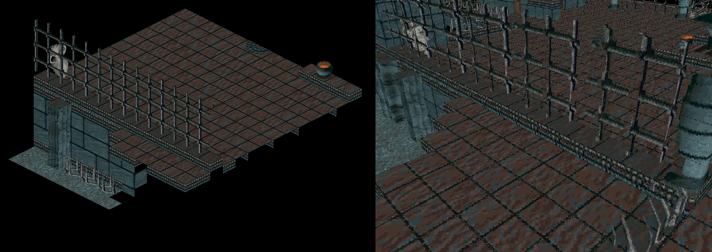
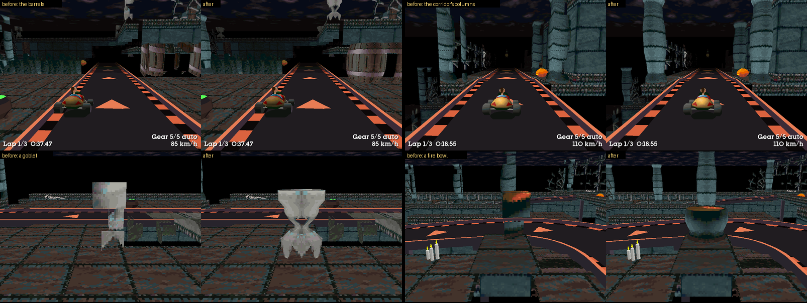
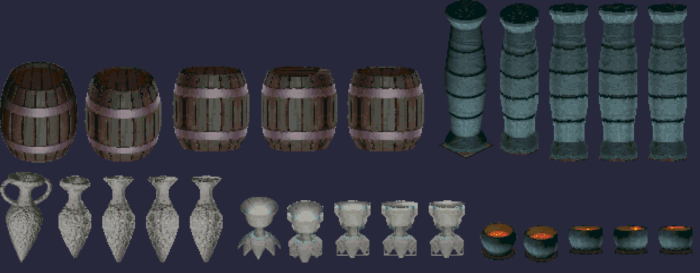
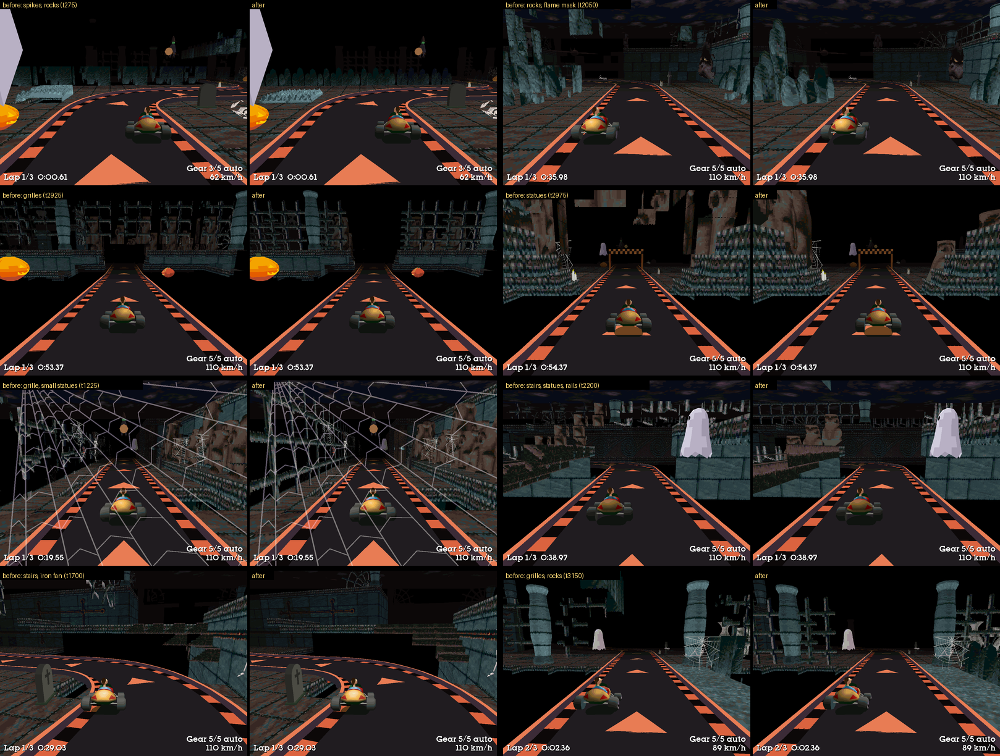
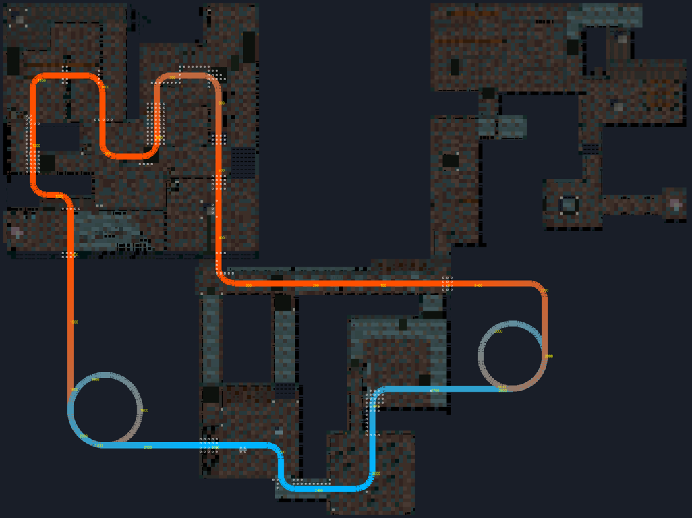
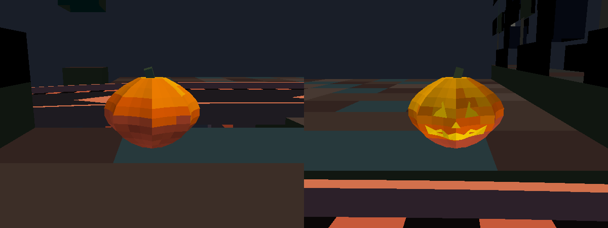
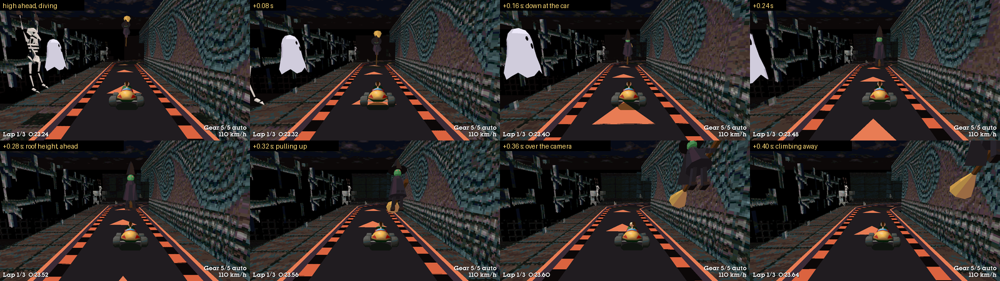
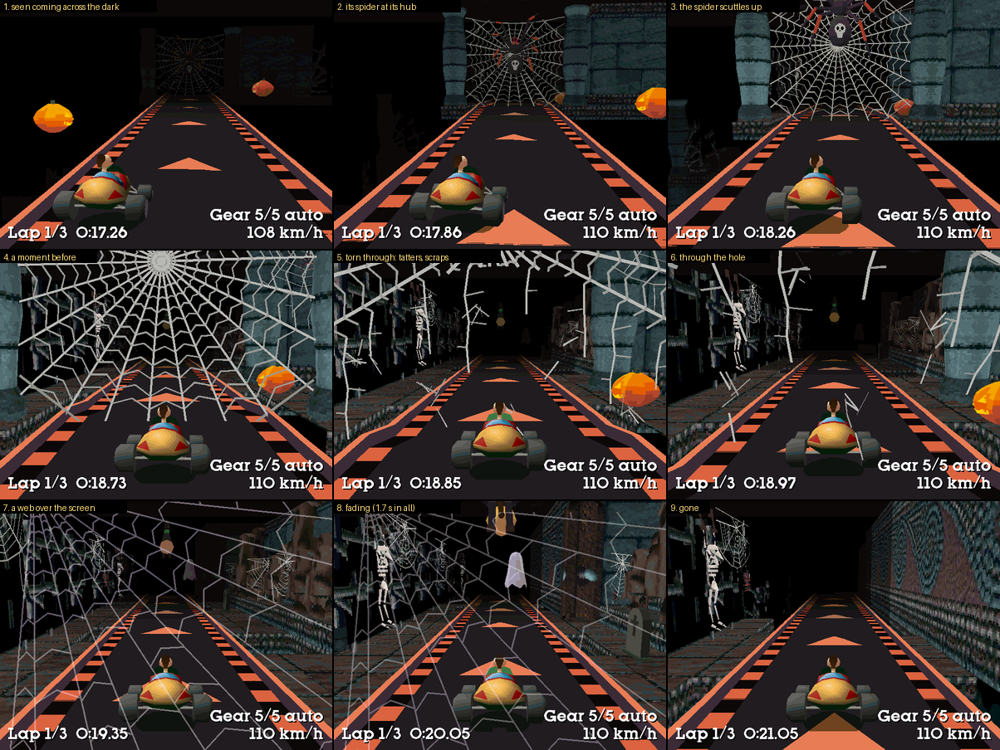
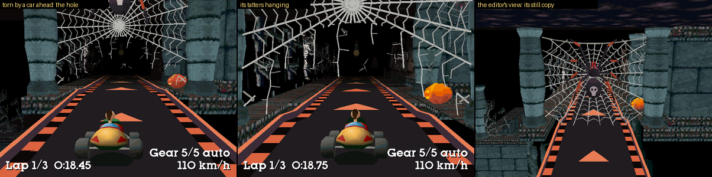
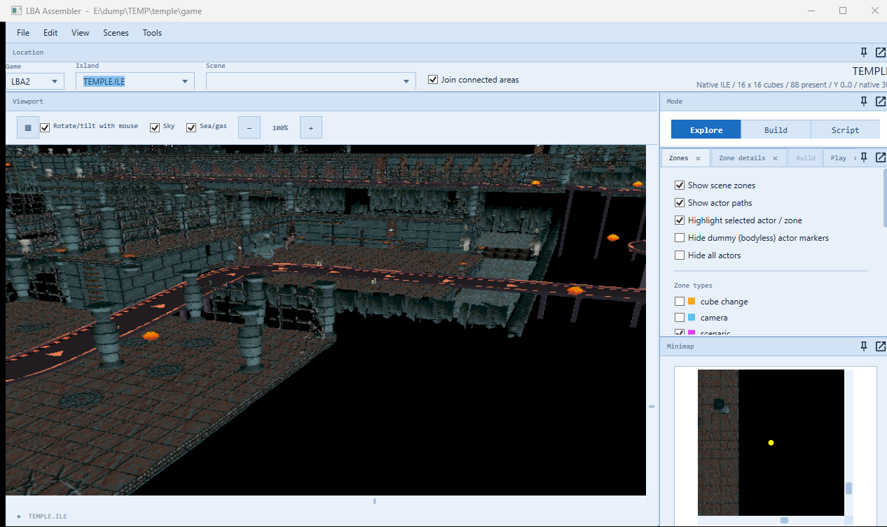

# The Temple of Bú: LBA1's temple as an LBA2 island, and its Halloween race (2026-10-16)

The user: "Port the temple of Bu from LBA1 into LBA2 as a separate island. Make sure it is visually the same with the same colour palette,
which means when viewed from the same angle as the fixed LBA1 angle it should match. After it's been ported generate a Halloween inspired
race track for it. This will be a separate release for a Halloween special track before our full racing mod is released. Let's make it as
creepy, scary, and Halloween inspired as we can do, let's turn our mushroom pickups into mini pumpkins. Add lots of typical Halloween decor,
pumpkins, witches, ghosts etc."

**To use it:**

- **The island on its own:** Tools > **LBA2: Temple of Bú (from LBA1)…** adds it to the game folder (both game folders must be set under
  File > Settings: it reads LBA1's scenes). The same menu builds it again or takes it out. Then pick `TEMPLE.ILE` in the Island list.
- **The race:** tick **The Temple of Bú: the Halloween race** in the race track window and Build. The build makes the island afresh, with
  doorways cut where the road goes. Then open `TEMPLE.ILE` and Play.

Only LBA Assembler's own engine draws it right: it is raced as Otringal's island 4 drawn from `TEMPLE.ILE`, in a palette and under a sky of its
own (the race file's `island_file=4 temple`, `island_palette=40`, `island_sky=24`).

## The port

**The layout** (`Terrain/Temple/TempleLayout.cs`): the temple is LBA1's scenes 8 (the first floor), 40 (the crypt, sixteen layers lower, and
the long corridor) and 41, placed as the joined map (`Lba1Areas`, "Temple of Bú") has them: 24,516 cells.

**The frame** (`TempleFrame`): every cell is three times LBA1's size each way (Scale 3). The corridors, five to seven cells wide in LBA1, are
15 to 21 cells for the cars, the palace's doorway width. The temple's 34 layers then stand 26,112 high, under the engine's 32,767. A uniform
scale keeps the look from LBA1's angle the same. The island is 11 × 8 cubes (2..12 × 3..10), the temple from cell (224, 256).

**The objects** (`TempleObjects.cs`): every LBA1 cell is a box textured with its brick's own faces, unskewed from the isometric sprite (the
code is Polar Island's, `PolarTextures`). LBA1's interior bricks draw only the faces the grid leaves to be seen: a floor tile only its top,
a wall brick only the side it faces. So a brick that draws any face whole is a whole block. Only bricks that draw no face whole (a lamp's
pole, a rail) get the box their outline fits. Where a brick draws nothing on a face, the face is see-through (polygon type 12, "incrusted":
colour 0 isn't drawn): the railings' gaps, the cobwebs' strands, the skull lamps' surroundings. A face is left out where the box beyond it
is solid there. The bodies only draw (their decors' boxes touch nothing). What is solid is 7,663 merged boxes of their own, with LBA1's
stairs (shapes 2-5) as four steps each. 1,108 different brick faces on 11 object pages, 74,332 faces in 1,589 bodies.

**The round things** (`TempleShapes.cs`, 2026-10-17): the user: "Let's also improve the graphics for the temple track as some things like
barrels aren't correctly reproduced in 3D." A box with a barrel's picture on each side is a crate with a barrel painted on it. So the
temple's round things are turned instead: its barrels, its 99 columns, its amphorae, the goblets on its walls and its fire bowls.

- *The shape*: LBA1 places each as a block of its library (a column 1 × 8 × 1 cells, the barrel 2 × 4 × 2), its picture split among the
  block's bricks. The bricks drawn together are the thing as LBA1's camera sees it, looking down at 30°: a ring about an upright axis is
  an ellipse twice as wide as tall. Row by row, the picture's width about the axis is the thing's width at that height (with an amphora
  only the part of each row that holds a whole ellipse: its handles, which meet its mouth, are left out). Its top and bottom are the
  flattest the outline allows: a barrel's lid, a column's capital. 12 to 24 sides round, the profile followed to 0.02 cells.
- *Its texture*: LBA1's picture on it. Each texel is the picture's pixel where that point falls from LBA1's angle, on the quarter of the
  ring facing LBA1's camera, where its picture is least foreshortened. The other three quarters are its mirror images in turn, so the
  barrel's staves and hoops go all round it. Its top is the picture's top: the barrel's lid, the fire in a bowl. Where the picture has
  nothing (a goblet's foot, between its points), the texture is see-through.
- *Cell by cell*: each cell draws the part of the thing in it: a layer of the ring, and of the barrel, whose axis stands between four
  cells, the quarter in the cell. LBA1 gives no brick to the barrel's back quarter, which its camera never sees, so the brick across from
  it draws that quarter too. Where LBA1 placed two barrels (or columns) overlapping, one's picture in front of the other's, both are drawn
  whole. Where the race track's doorways cut through a round thing, the rest of it goes too: no column's top hangs over the road, and no
  fire bowl stands on nothing (38 cells).
- What is solid is unchanged: each cell's box, as before.
- From LBA1's angle the port still draws LBA1's picture. In the race track's build the temple has about 92,500 faces in 1,725 bodies
  (71,800 in 1,743 before), frame times are no longer, and the test pilot's laps are the same to a hundredth of a second.

`ScriptRoundTrip templeblocks <LBA1> <out>` lists the blocks the temple's grids place, with a picture of each and every placement
(blocks.csv). `templeshapes <LBA1> <out>` prints each round thing's profile and draws it as above.

**The shaped things** (`TempleModels.cs` and its parts, 2026-10-17): the user: "The Temple track still has a lot of blocky objects from
the conversion that need refining."

*What was blocky*, from the race's point of view: the test pilot's solo lap, its camera traced every frame (`camtrace 1`), and every
tenth frame cast through the temple's cells as the race track's build has them (`templecells`), each pixel the LBA1 block it meets first,
the road's deck in front of them. Floors (11.9 % of the screen on average), walls (4.0 %), the frieze (1.8 %) and the wall panels (0.7 %)
are boxes in LBA1 too, and the turned columns took 1.8 %. Of the rest, ranked:

| What | Frames it shows in (of 276) | Of the screen on average | At most | Now |
|---|---|---|---|---|
| Rocks: clusters of rounded lobes along the walls | 107 | 2.63 % | 22.6 % | rows of lobes |
| Grilles: the lattice fences, the crypt's galleries | 103 | 1.55 % | 13.1 % | a cut-out in their plane |
| The seated statues | 18 | 0.32 % | 14.6 % | figures |
| Iron fans: quarter-circle grilles in corners | 54 | 0.30 % | 3.7 % | cut-outs |
| Spiked rails, along stairs and wall tops | 27 | 0.24 % | 7.9 % | cut-outs |
| Stairs | 25 | 0.22 % | 6.9 % | steps |
| The small statues | 20 | 0.21 % | 5.5 % | figures |
| Totem posts | 17 | 0.18 % | 13.2 % | left: square posts in LBA1 too |
| Walls with shelves | 14 | 0.18 % | 8.9 % | left: walls |
| Rock pillars | 8 | 0.11 % | 6.4 % | left: square |
| The dais with sloped edges | 5 | 0.05 % | 4.2 % | left |
| Stone benches | 7 | 0.05 % | 4.2 % | left |
| The bed of spikes in the start room | 9 | 0.04 % | 2.2 % | spikes |
| The flame masks | 6 | 0.03 % | 2.1 % | figures |
| The rabbit statue | 3 | 0.01 % | 0.9 % | a figure |

Left too: the rocks hanging from the crypt's ceiling (always under the road, never seen from it), the tilted and lying amphorae and the
plank slopes beside the stairs (a frame each).

*What they became.* Each kind is read from its block's picture, LBA1's view of it from 30 degrees up, its own way (`Make`), and each
texel of a model is the picture's pixel where that point of it falls from LBA1's angle, as the round things' are:

- *Grilles, spiked rails, iron fans* (`Panel`): flat things standing in one upright plane along the block. The picture places the plane: a
  drawn pixel is the point of a plane at t across the block that LBA1's view sees there, and the plane is the t whose points of the
  drawn pixels lie inside the block (of those, the one standing lowest): 0.41 of the way across a grille's cell, 0.66 a rail's. Each cell's
  square of it is a see-through quad, front and back, with LBA1's picture unskewed onto it -- the bars, their knobs and the spikes as LBA1
  draws them, at one depth. The boxes had unskewed them onto their faces, each at a face's own depth: crosses floating apart. 42 faces a
  grille.
- *Stairs* (`Steps`): the two steps a cell LBA1 draws, each a tread, a riser and its sides, and the cell's back -- a side against a step
  of the same stairs, or against a wall, left out.
- *Rocks* (`Lobes`): a row of upright lobes along the block, half a cell apart (6 along a 3-cell block), by turns behind and in front:
  one behind as tall as the picture's outline over its share of the row, one in front three quarters to nine tenths of that, each a little
  wider or narrower (by turns that look random, the same every build) -- a cluster, not a fence. A lobe: an ellipse across (no deeper than
  the block), its top rounded to a point; 6 sides, 18 faces, two tiles.
- *Statues, flame masks, the rabbit* (`Figure`): a figure is the same either side of the way it faces, so its other side's view is
  LBA1's picture mirrored. Its shape is what both views leave of the block: the voxels (a twelfth of a cell, an eighth of a layer) whose
  point falls on the figure from LBA1's angle and whose mirror image -- across the block's middle along x or z, whichever leaves more: the
  way it faces -- does too. Slice by slice, a ring of 12 points round the slice's middle, each as far as it reaches that way, smoothed;
  the rings kept where the shape turns: 96 to 108 faces a statue. A side's texels are the picture's where the view that sees it best sees
  it (the mirror image's: the picture at the mirrored point); its back, which neither sees, has its sides' colours. (Lathed, the last
  round, they came out bottles.)
- *The bed of spikes* (`Spikes`): 8 x 8 four-sided points on a plate, as tall as the picture's farthest point (0.67 layers).

- *Cell by cell*: a model's face is drawn by the cell of its placement it lies in, so a chunk's body holds what is in its cells. A face
  turned to a solid block a fifth of a cell out of it (a rock's back against its wall, a statue's foot on its floor) is left out: 1,338.
- *The doorways*: where the race track's doorways cut a statue, stairs or the spikes, all of it goes, as a round thing does (no statue
  cut in two); of a grille, a rail or a row of rocks, the columns along it they cut (no grille's top hanging over the road), the rest stays,
  as the boxes did. 276 cells in all.
- *What is solid* is the cells' boxes, as before, less those the doorways took with them: 7,161 boxes (7,326). The test pilot's solo laps
  are the same to a hundredth of a second (55.50, 55.00, 55.06 s), and the race file the same.
- From LBA1's angle the port draws much LBA1's picture still -- the statues and the grilles closely, the rocks as a cluster of lobes like
  LBA1's, if not the same lobes.

In the race track's build the temple has 104,700 faces in 1,587 bodies (92,500 in 1,725 before): 39,300 of boxes (68,100), 24,400 of
round things, and 41,000 of the models (rocks 25,300, grilles 6,200, small statues 2,500, statues 2,100, iron fans 2,000, stairs 1,000,
flame masks 600, rails 540, the rabbit 390, the spikes 260), on 11 object pages (12). Frame times are no longer: over the test
pilot's lap, each frame's least drawing time of three runs (the two builds by turns), 11.6 ms on average, 15.9 ms at the 95th
percentile (12.2 and 16.1 before; 640 x 480).

`templemodels <LBA1> <out>` prints what each model read from its picture and draws it as above; `templecells <LBA1> <plan.json> <out.csv>`
lists every cell as the race track's build has it (its block, brick, box, whether cut), for the survey's ray cast.

**The colours** (`TemplePalette.cs`): an island's palette colours the cars, Twinsen and the screen's text by index too, and every retail
island has the same palette, tuned a little. So LBA1's whole palette won't do. Instead, Otringal's has the temple's colours written into it:
each, the most drawn first, into the nearest slot no other has taken, when it is within 24 (a colour an actor drawn there hardly sees
change). 96 of the temple's 106 colours get slots of their own, 99.98 % of its pixels: those are exact. The shading and fog table is made
for that palette. Its row 12 (the level objects' textures are drawn at) is the palette itself. Its fog is black: far rooms fade into the
dark, as LBA1 draws the temple in the black. Measured on a render from LBA1's angle: 100 % of the temple's drawn pixels are LBA1 palette
colours, and the mean colour is within 0.7 (of 255) of LBA1's own picture's.

**RESS.HQR**: the palette goes in entry 40 and a night sky (dark violet clouds, a black sea) in entry 24. These are RESS_XPL0 + 13 and
RESS_SKYSEA0 + 13, slots the retail file leaves empty.

**The engine**:

- `AMBIANCE.CPP` ChoicePalette takes the race-track mode's `island_palette=` and the editor view's `IslandPaletteOverride`. The editor's
  island loads left CubeMode at interior, so its palette had always been citabau's (only its colours, converted with the island's own
  palette, hid it).
- `EXTFUNC.CPP` takes `island_sky=`.
- `RENDERER_API.CPP` maps "temple" to island 4 with entries 40 and 24.
- Object pages: 32, the decor's page in its Body's bits 18-22 (`MAX_OBJ_PAGES`, `IslandFile.MaxObjectPages`).

**Commands** (ScriptRoundTrip):

- `templebuild <LBA1> <LBA2 game>`: the plain island into a folder.
- `templeregion <LBA1> <png> [x0 x1 z0 z1]`: LBA1's own picture of the temple.
- `templemap <LBA1> <png>`: a height map.
- `templecolours`, `templebricks`: the colour and brick studies.
- `templeblocks <LBA1> <out>`, `templeshapes <LBA1> <out>`: the blocks the grids place, and the round things turned (above).
- `templemodels <LBA1> <out>`, `templecells <LBA1> <plan.json> <out.csv>`: the shaped things made models, and every cell as the race
  track's build has it (above).
- `polarview` with `VIEW_ISLAND=TEMPLE VIEW_Y=<height>` renders it from any angle. LBA1's is pitch 341, yaw 3584.

## The Halloween race

The plan is `docs/racetrack/temple_track_plan.json`, from `tools/RaceTrackPlan/temple_design.py`, which reads a plain build's `TEMPLE.JSON`.
LBA1's temple is a dungeon at three heights: the first floor and its corridor at 14,080, scene 8's lower hall at 11,008, and the crypt at
1,792. In LBA1 these are joined by narrow stairs, with dead ends and no way round. The lap is a raised road a little over the floors (rail
held). Where it passes walls, it goes through doorways cut in them: 819 cells, the plan's `templeCuts`. Between the heights it runs on
ramps, and down to the crypt and back up on spirals through the black void round the temple. 1,719 cells, steepest 12 %; about 65 s a lap
with a car at 110 km/h.

1. The start, on the straight through the crypt's west room, heading east. The opponents wait on its floor while the player qualifies (the
   plan's pit spots).
2. Through the crypt's rooms: the lower passage, the south-east room, north into the east room.
3. Out of its east side and up a spiral to the long corridor's east end.
4. West along the corridor: its floor is twelve cells wide, so the road is eight, and the spiral frieze on its north wall stays whole.
5. North into the first floor, down a ramp into the lower hall, round it, up into the west rooms and round them.
6. Out over the first floor's open south edge and down a spiral to the crypt.

**Halloween** (`TempleHalloween.cs`, the plan's `halloween`):

- *The road*: the deck theme `halloween`: near black, pumpkin-orange and black curbs, glowing orange rail tops, dark plum sides. The start
  gantry is in orange and black squares (`DeckTheme.Gantry`).
- *Decor* (drawn only, nothing to bump into), 86 pieces: jack-o'-lanterns beside the road on the floors and hanging in the dark over the
  void. Their carved faces glow in the palette's fire colours (240-247, the same in every island's palette). There are gravestones and
  crosses with candles, witches' cauldrons brimming with glowing green brew, and a totem of giant jack-o'-lanterns up each spiral's middle.
- *Spooks*, 27: bodies of BODY.HQR the race-track mode flies and draws itself, as it draws the Wannies' frog (`RACEMOD.CPP spook=<body>
  <flags> <height> <way...>`). There are no actors, so no scene limit and no animations to fit. Witches on their broomsticks circle the
  spirals and patrol the corridor, the lower hall and the crypt. Every few seconds one stops and throws a fire ball at a car below her
  (flags 1; a hit stuns the car as a gas monster's does, "hit by a witch's fire ball"). Ghosts drift across the road a little over the
  cars, and bats wheel high over it (flags 2: round and round their way).
- *Mini pumpkins*: the power-ups' mushrooms, the fakes the cars drop and the item box's icon are a jack-o'-lantern. It is the mushroom
  entity 112's body 3.
- *The music*: the scenes play LBA2's own Temple of Bù's music (3) and its ambient sounds (scene 10).
- *The line-up*: the Dark Monk (the one to beat), Ker'aooc in her cauldron and Tabata on his spell book.

The scenes are 301-327, one for each cube the road's width crosses (`TempleTrack.SceneCubes`). The start scene is 326.

### Skeletons, scares and the ghost (2026-10-17)

The user: "Let's make the temple track creepier with some skeletons and also do visual scares, perhaps a witch dive bombing at the player
and pulling up at the last second to avoid a collision", and "a special item to the temple track of a ghost pickup that when used targets
the other cars and briefly covers the screen with a ghost outline, we should make this translucent enough for a player to see through and
not make it last more than about 10 seconds".

- *Skeletons* (`TempleHalloween.Skeletons.cs`, the plan's decor kinds 6-9): LBA1's own skeleton, the one that wakes up in LBA1's temple
  (LBA1 BODY.HQR 55, its knife left out), posed with its own animations (ANIM.HQR 244 sleeping, 245 waking up, 246 standing) and by hand,
  1.4 times LBA1's size, and made decor bodies of one bone in the temple's palette like the rest of Halloween (bone: the warm greys 231-239).
  23 of them beside the lap, drawn only: 7 lying on their backs by the road, 3 slumped against walls where the wall is far enough from the
  road for their legs, 6 hanging by their wrists in chains on the walls, 7 hanging on long chains in the dark beside the spirals and the
  straight over the void. The build needs the LBA1 folder for them (it has it for the temple itself).
- *The witches' dives* (`RACEMOD.CPP dive=`, Dives): six places over the lap where nothing of the temple stands over the road (the plan's
  `dives`: the long corridor twice, the straight over the dark, both spirals, the crypt's straight). As Twinsen's car comes 28 cells along
  the lap from one, 70 % of the times a witch (the spooks' witch body) sets off from 6,000-8,000 over the road there, glides, dives steeply
  along the road at the car, pulls up out of the dive 6 cells ahead of it, skims over its roof and climbs away behind it, over the camera.
  Her place is worked out from the car's own every frame (how far ahead of it she is along the guide line), so she is never lower over
  the car than 320-620 over the top of its box, whatever it does. Nothing is hit or slowed; the log says how close each one came
  ("the witch's dive (place 1) over after 1.2 s: at the closest her lowest point 436 over the top of the car's box ... never touching").
- *Things jumping up* (`scare=`, Scares): eight places beside the road on the floors (the plan's `scares`): as the car comes within 14
  cells, 75 % of the times a skeleton reaching out with both arms (LBA1's skeleton, standing) or a ghost jumps up out of the floor, lunges at
  the road for 1.4 s and sinks back.
- *The ghost power-up* (`haunt=`, PU_GHOST, after the golden Gazogem so every other track's items keep their numbers): drawn from the
  pumpkins only on the temple, more often by the cars at the back. Twinsen's haunts every other car for 5 s: slowed to 80 %, weaving up to
  1.2 cells across its road (never past its edge less a car's half width) with its nose swinging, a ghost circling over it. Another car's
  haunts Twinsen: a ghost's outline over his screen, 84 % of its height, bobbing -- the scene under its sheet blended 22 % of the way to
  its pale lavender, its outline 60 %, its eyes and mouth half way to black (each pixel the palette's nearest colour, dithered), fading in
  over 0.7 s and out over the last 3 s, 8 s in all; one at a time. The protection spell and the super jet-pack keep it off, as they do the
  other attacks; a saved game loaded forgets it (ForgetPowerUps). Its item box icon is the ghost.

- *The ghost's flight* (2026-10-17, later -- the user: "The ghost powerup has no visual effect when a player launches it, let's have it
  rise up, split into one ghost for each car, and then fly off to haunt them"; RACEMOD.CPP `GhostLaunch`, `GhostPlace`, `Ghosts`,
  `HauntCar`). Twinsen's ghost rises out of his car (0.24 s, to 350 over its roof and 1,800 ahead of it, in sight of the camera behind
  it -- straight over the car it rose out of the top of the screen), hovers turning (0.14 s: a whole turn since it set off), then splits
  into one ghost for each car it is to haunt -- the cars it always haunted: racing, and not on a super jet-pack (checked again as each
  gets there: a car that took a jet-pack meanwhile isn't caught) -- fanned out 0.75 rad apart. Each flies its own curve to its car
  (out the fan's way and up, in from behind and over the car), both ends moving with their cars, in its distance at 24,000 a second:
  0.32 s at the least, 0.76 s at the most -- a car further off, or in another scene, gets the most, its ghost off towards it into the
  distance. It gets there where the circle round the car starts, on the side it comes from, and becomes the circling ghost: the
  haunting starts then (5 s, as before), the ghost already at its height (it doesn't rise out of the car first, as a ghost not flown
  there does), sinking into the car at the end. From Ctrl to each haunting: 0.70 s for the cars near, 1.14 s for the far ones (0 before:
  at once). To a car behind Twinsen's, the curve climbs steeply first, over the camera and out of the top of the screen; none is drawn
  within 2,200 of the camera (going by it, it filled the screen). With no other car to haunt it flies up and away. Drawn as the circling
  ghosts are (`DrawOver`: the ghost's body, depth-tested against the scene, in its fog). Logged: "Twinsen's ghost rises out of his car:
  3 other cars to haunt", "Twinsen's ghost splits into 3, flying to The Dark Monk (7.7 cells, 0.32 s), ... (136.6 cells, far, 0.76 s)",
  "Twinsen's ghost reaches The Dark Monk, 0.70 s after it was used".
- *Another car's ghost* rises out of its car the same way and flies at Twinsen's camera: it ends 2,200 in front of it on its view,
  facing it -- about the size of the ghost then over his screen -- coming in from further along the view (from behind the camera: over
  it first). As it gets there the screen's ghost starts, half faded in already (the flying one become it); the protection spell and the
  super jet-pack keep it off then, as before. 0.70-1.14 s after the car took it. ("Ker'aooc's cauldron's ghost flies at Twinsen's car
  (15.1 cells off, 0.32 s)", "... reaches Twinsen's car, 0.72 s after it was taken".)
- Without the ghost's body (no `haunt=`: a console test elsewhere) it all happens at once, as before; no other track draws a ghost.

Console (tests): `racedive [place]` a witch dives now, `racehaunt [n]` the screen haunted as by another car's ghost (with n, opponent n's,
1 the first, flying from its car), `racescare [n]` a scare jumps up now, `raceitem 12` Twinsen's ghost on the others. Tests:
`E:\dump\TEMP\ghostfx` -- `ghost.sh <tag>` (AT, CMD, PILOT=0 to stand on the grid, SLOW=<k> a slower car), `sheet.sh`, `races.sh`.

### Cobwebs and the giant web (2026-10-17)

The user: "Can we also improve the temple track add in some cobwebs, perhaps a giant cobweb we have to drive through."

- *The giant web* (`TempleHalloween.Cobwebs.cs`, the plan's `giantWebs`): across the long corridor's east doorway, between the two columns
  either side of the road there, 12 cells across and 5,600 high. The lap comes up to it out of the dark at the top of the east spiral, 60
  cells of straight, so it is seen from across the dark. An orb web of 26 radials and a spiral sagging between them, its strands pale
  ribbons of the palette's greys (58-60), facing the cars coming. A giant spider (dark purple, its legs banded rust, eight glowing red eyes,
  a pale skull on its back) sits at its hub, its back to the cars.
- *What happens* (`RACEMOD.CPP web=`, Webs): a car coming within 34 cells sends the spider scuttling up to the web's top thread, its legs
  in turn, in 0.9 s. A car -- any, the opponents too -- crossing it between the columns tears it ("Twinsen's car tears through the giant
  web"): its middle, half an ellipse standing on the road the road's width and the camera's height, is gone; tatters hang from the torn
  threads round the hole, flung along the way by the car and swinging back, dying down to a sway; scraps of web fly after the car for 1.3 s,
  tumbling and falling. The cars after it go through the hole ("... goes through the torn giant web"). 15 s after the tear it is whole
  again, its spider back at its hub -- but never while Twinsen's car is coming up to it, so he never sees it mend.
- *On the screen*: Twinsen's car tearing it, a web sticks over his screen as the camera goes through (0.3 s after the car): its hub off
  the top left, its threads across the screen, torn here and there, see-through as the ghost's overlay is (the haunting's blend tables,
  42 % of the way to its pale colour at the most), sliding down a little and fading out, 1.7 s in all. Nothing slows or stops any car: the
  test pilot's solo laps are the same to the hundredth of a second as before.
- *How it is drawn*: by the race-track mode, into the background as the giant frog is (its depth written: a car behind its strands is hidden
  by them). The race file has the web (`web=`) and its parts (`web_part=`: 0 drawn always -- the frame and what a car leaves, 1 its middle
  while whole, 2 a tatter once torn, 3 a scrap after the tear), bodies of BODY.HQR the build appends (12: the frame's and the middle's
  pieces, three tatters, two scraps, the spider's two leg poses). Its faces are pieces of no more than 700 (the near plane; the close flag):
  the camera goes through it. A still copy, whole with its spider, stands among the island's decor for the editor's view (the frog's way:
  hidden while racing by game variable 212, the temple's held variable).

- *Cobwebs round the lap* (the plan's decor kinds 10-15, drawn only): 30 webs and 9 spiders, none over the road. In the corners of the walls
  beside it, hanging from the walls' tops (13, two big); across a door gap (1); between two of LBA1's columns (1); flat on the walls, as
  LBA1's own cobwebs are, either side of the doorways the road goes through and along the walls beside it (15; not the corridor's frieze,
  nor where a skeleton hangs); and small spiders hanging on their threads in front of every third corner's and wall's. Each is an orb web:
  radials fanned from its hub, a spiral round them, threads hanging from an old one's bottom -- three of each corner's and wall's, made
  differently. Its strands are thin pale ribbons seen from both sides.

Console (tests): `raceweb [0|1|2|3]`: the giant web torn now as by Twinsen's car (1, none: the web over his screen too), whole again (0),
its spider off up its web (2), torn as by another car (3).

### Twinsen's pumpkin F1 (2026-10-17)

The user: "Let's create a pumpkin inspired F1 car for our Temple track for Twinsen to drive."

- *The car* (`RaceTrackCharacterCars.Pumpkin.cs`, `BuildPumpkin`): a single-seater on the cars' kit (CarMesh, the racer's 18 bones). A
  long, low nose rising to the cockpit; round the cockpit's back half the sidepods and the engine cover are one big pumpkin lying along
  the car, six lobes ribbed down its length (each lobe's points its own, so the game's light shades it round, darker lines in the
  grooves). Its colours are the fire oranges the Temple's own pumpkins are (241 on, taking 0.28 of the light: 241-243 as the light falls,
  red-orange to amber); in other islands' palettes their tables make them those islands' oranges and golds. The pumpkin's front is a
  jack-o'-lantern's face, glowing (244): the sidepods' inlets its eyes, the car's nose its nose, a toothy grin under it; its back a small
  face, its grin the rain light and the exhaust's glowing ember (245) its nose -- what the chase camera sees. The airbox is the pumpkin's
  ridged olive stalk behind Twinsen's head, bent forward, its cut end the intake; the wings are green planes between pumpkin leaves (the
  endplates, veined), a vine's tendril curling over the rear wing. Four exposed wheels on thin black wishbones: black slicks, the rear
  ones banded orange round the wall, green wheels with orange caps. Twinsen (BODY.HQR 1, cut at the rim, his arms down in the cockpit)
  shows his shoulders, head and ponytail. 521 points, 455 polygons, 68 lines and 8 spheres (the engine's limits: 550 each); its box its own
  (x ±550, y 0..750, z -776..890: longer than the racer's car it is made on).
- *Where it is*: race car 220 of RACECARS.JSON ("Pumpkin F1", driven by Twinsen), the racer entity's body 64 and its half-size copy 164
  (the lightning spell). Every build adds it after every track's bodies (`InstallPumpkin`, at the end of `RaceTrackService.Build`), so no
  other body moves: a build's files differ from the build before only by BODY.HQR's two new last entries, RESS.HQR's entity table and
  RACECARS.JSON's new last line.
- *Twinsen's on the Temple*: the car setup's "drive as" -1 is now *Twinsen's own car*: his buggy, or the car a track has for him
  (`RaceTrackCharacterCars.TrackCar`: the Temple of Bú's the pumpkin F1). The car file of the Temple then has its `drive_as=`
  (`RaceCarEngineFile.TrackCarLines`, `RaceCarSetup.TrackCarKeys`); the other tracks' don't. Any other choice in the Race car window wins
  -- a character's car, the laser buggies, or "Twinsen's buggy, on every track" (-4). Race car setup > Your car lists the pumpkin F1 at the
  top of the cars, to drive anywhere; the race game's car page opens on it (the installer's `GameInstall.Cars`).
- *It handles as the buggy*: it is drawn in the buggy's place (`RACEMOD.CPP drive_as=`, the opponents' driving animation: it bounces the
  car and its wheels; no wheel spins or steers in it, as in the other cars), pitched with the road. The test pilot's race against the
  opponents (same race seed) is the same to the hundredth of a second in the pumpkin F1 as in the buggy and as the build before: 57.46,
  63.97, 59.96 s, 1st of 4, no rescues.

**Tests**:

- `E:\dump\TEMP\temple\pilot\run.sh <tag> <ticks>` is the headless pilot. CARF=car_fast.txt is a fast car with no qualifying.
- `E:\dump\TEMP\temple\ui\ui_temple.ps1` builds in the race window, opens TEMPLE.ILE and Plays.
- A regression build of every other track gives its 44 files byte-identical to the code before.
- The cobwebs' round: `E:\dump\TEMP\templeweb` -- `suite.sh <tag>` (a race against the opponents, the pilot off its line, solo),
  `shots.sh <tag> <every>` (a lap of screenshots), `regress.sh head|work` (every other track: 58 built files and 17 race files the same),
  `templecmp.sh` (the temple alone: only TEMPLE.ILE, TEMPLE.OBL, RACETRACK.JSON and BODY.HQR differ -- its entries before the giant web's the
  same -- and the race file only gains its web lines).
- The pumpkin F1: `ScriptRoundTrip pumpkinf1 <game> <scratch>` installs it into copies of a folder's BODY.HQR, RESS.HQR and RACECARS.JSON
  (then `BodyPipeline carviews <scratch>\BODY.HQR <index> <game> <png> 40`); `E:\dump\TEMP\pumpkinf1` -- `views.sh <tag>` (the views),
  `suite.sh <tag>` (the race in HEAD's build, in this build in the buggy, `RT_DRIVE=-4`, and in the pumpkin F1, a fixed
  `qualifying_seed=`), `others.sh head|work` (every other track built together: 59 of 62 files the same, BODY.HQR only gaining its two
  last entries, RESS.HQR only its entry 44, RACECARS.JSON only its last line).
- The shaped things' round: `E:\dump\TEMP\templerefine` -- `build.sh <game> head|work`, `racefile.sh`, `pilot.sh`, `shots.sh <tag> <every>`
  (a lap of screenshots, HEAD's build gameH and the worktree's gameW frame for frame), `suite.sh` (solo, against the opponents, off its
  line, on both), `perfab.sh` (both timed by turns, each frame's least time over the runs: the machine is shared), `raycast.py` (the
  survey, from a `camtrace 1` run and `templecells`), `checks.sh` (the temple alone: only TEMPLE.ILE and TEMPLE.OBL differ, the race file
  the same; every other track: its built files and its race file the same).

